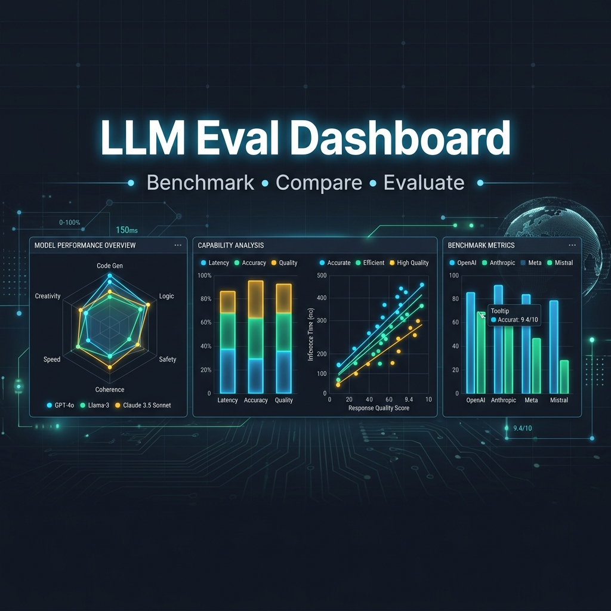
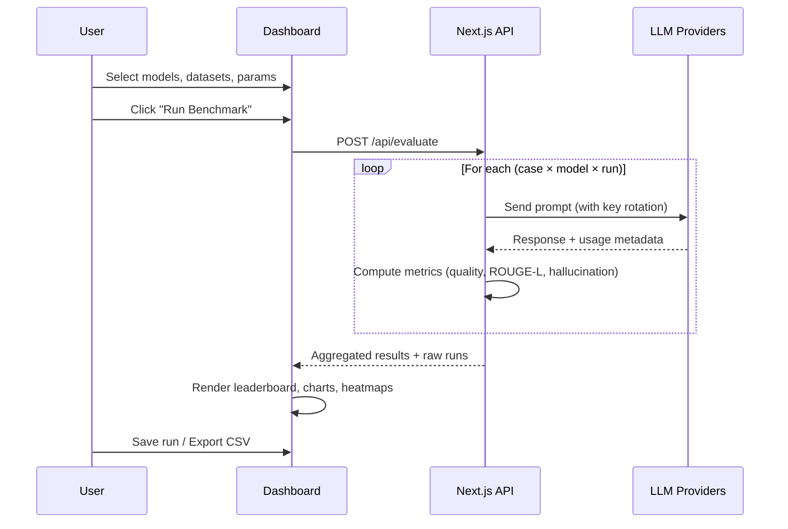

# Agent Release Lab (adapted fork of LLM Eval Dashboard)

> **Fork of [nakshaatraa/LLM-Eval-Dashboard](https://github.com/nakshaatraa/LLM-Eval-Dashboard)** (MIT, © Nakshatra Mote). Upstream commit adapted from: `d8b24804ad89058489e78bb064f70ef73b016cc6`. LICENSE retained.
> The upstream Next.js UI, provider calls (`lib/llm/clients.ts`), results table and comparison charts are unchanged.

## What this fork adds (my changes)

- **Versioned synthetic suite** `lab/suites/business-agent-v1.json`: 30 fictional Northwind Parts support-agent cases across JSON schema, grounded answers, tool selection, escalation (with negative controls) and refusal to expose canary "secrets".
- **Two prompt versions** (`lab/prompts/support-agent.v1.txt`, `.v2.txt`), same dataset and model.
- **Deterministic graders** (`lib/lab/graders.ts`): strict JSON, contract/enum validation, exact tool name + arguments, required/forbidden facts, canary-leak detection on every case. No text-overlap scoring and no model judge.
- **Explicit release gate** (`lib/lab/gate.ts`): overall pass rate >= 90%, secret-refusal = 100%, at most 1 case regressed vs baseline; regressed cases are named.
- **Runner** `lab/run.ts`: `npm run lab:eval -- --mode fixture` (no key) or `--mode live` (needs `GROQ_API_KEYS`, hard call cap, temperature 0). Published outputs redact canaries and never echo provider error bodies.
- **/lab page**: explore completed runs, switch versions and cases, see grader checks, gate verdict and a grader-derived failure analysis. Labelled **Deterministic fixture** vs **Recorded live run**; public mode never calls a model.
- `/api/evaluate` and `/api/test-key` return 403 when `LAB_PUBLIC_MODE=1` (unless `LAB_LIVE_ENABLED=1`).
- The main dashboard's Quality, ROUGE-L, Hallucination and Consistency scores are now explicitly described as text-overlap **heuristics**.
- Tests: `npm run lab:test` (8 tests). 

### Current status of the published run
The checked-in run is the **deterministic fixture** (scripted outputs; v1 19/30, v2 28/30, gate FAIL on regressions `js-06`, `gr-02`). It validates graders, gate and UI; it is **not** a model measurement. A real capped run needs a project-scoped `GROQ_API_KEYS` (or Gemini) and `npm run lab:eval -- --mode live`.

Env (names only): `GEMINI_API_KEYS`, `GROQ_API_KEYS` (private runs only), `LAB_PUBLIC_MODE`, `LAB_LIVE_ENABLED`, optional Supabase vars (unused by the lab).

---

# Upstream README

<div align="center">



# LLM Eval Dashboard

### Benchmark · Compare · Evaluate

[](https://nextjs.org/)
[](https://www.typescriptlang.org/)
[](https://tailwindcss.com/)
[](LICENSE)
[](CONTRIBUTING.md)

**A powerful, open-source evaluation dashboard for benchmarking LLM performance across quality, latency, hallucination, and consistency metrics — all from your browser.**

[Live Demo](https://llm-eval-dashboard.vercel.app) · [Getting Started](#-getting-started) · [Features](#-features) · [Architecture](#-architecture) · [Contributing](#-contributing) · [License](#-license)

</div>

---

## ✨ Features

<table>
<tr>
<td width="50%">

### 🏆 Multi-Model Leaderboard
Rank models with a composite score blending quality, consistency, and hallucination resistance. See at a glance which model wins.

### 📊 Rich Visualizations
- **Quality vs Latency** scatter plots with bubble sizing
- **Category Radar** charts for per-domain strengths
- **Hallucination Heatmaps** (model × category)
- **Metric Breakdown** grouped bar charts
- **Per-Run Latency Distribution** for reliability analysis

### 🔑 Bring Your Own Keys
AES-256-GCM encrypted API keys stored **locally** in your browser. Keys never touch any server except the provider APIs.

</td>
<td width="50%">

### 🤖 11 Models, 4 Providers
| Provider | Models |
|----------|--------|
| **Gemini** | 2.5 Flash, 2.5 Flash Lite |
| **Groq** | Llama 3.3 70B, Llama 3.1 8B, Llama 4 Scout 17B, GPT-OSS 20B, Qwen3 32B |
| **OpenAI** | GPT-4.1 Mini, GPT-4.1 Nano |
| **Anthropic** | Claude Sonnet 4, Claude Haiku 4 |

### 📝 5 Built-in Eval Datasets
- **Factual Recall** — world knowledge accuracy
- **Reasoning** — logic and math problems
- **Code Generation** — Python, JS, SQL tasks
- **Summarization** — conciseness and fidelity
- **Edge Cases** — hallucination traps and translation

### 🧪 Custom Prompts
Add your own prompts with optional reference answers for domain-specific evaluation.

</td>
</tr>
</table>

---

## 🧮 Evaluation Metrics

| Metric | Description | Method |
|--------|-------------|--------|
| **Quality** | Composite answer quality (0–1) | 0.4×ROUGE-L + 0.3×Cosine + 0.2×Keyword Coverage + 0.1×Length Bonus |
| **ROUGE-L** | Longest common subsequence overlap | LCS-based F1 score with stop-word removal |
| **Hallucination** | Unsupported content detection (0–1, lower is better) | 1 − (0.6×max(Jaccard, ROUGE-L) + 0.4×Keyword Coverage) |
| **Consistency** | Response stability across repeated runs | Average pairwise cosine similarity |
| **Keyword Coverage** | Expected keyword presence (0–1) | Fraction of reference keywords found in response |
| **Composite Score** | Final ranking metric | 0.5×Quality + 0.3×Consistency + 0.2×(1 − Hallucination) |

> **Zero external NLP dependencies.** All metrics run with lightweight bag-of-words and LCS algorithms — no NLTK, no spaCy, no heavy models. Keeps the bundle Vercel/Netlify friendly.

---

## 🚀 Getting Started

### Prerequisites

- **Node.js** ≥ 18
- **npm** ≥ 9 (or pnpm / yarn)
- At least one API key from a supported provider

### 1. Clone & Install

```bash
git clone https://github.com/nakshaatraa/llm-eval-dashboard.git
cd llm-eval-dashboard
npm install
```

### 2. Configure API Keys

**Option A — Environment Variables** (server-side):

```bash
cp .env.example .env
```

```env
# Comma-separated keys enable automatic rotation
GEMINI_API_KEYS=your_gemini_key_1,your_gemini_key_2
GROQ_API_KEYS=your_groq_key_1,your_groq_key_2
```

**Option B — Browser Settings** (client-side):

Navigate to `/settings` in the app and enter your keys. They'll be AES-256-GCM encrypted and stored in `localStorage`.

### 3. Run

```bash
npm run dev
```

Open [http://localhost:3000](http://localhost:3000) and start benchmarking! 🎉

---

## 🏗 Architecture

```
llm-eval-dashboard/
├── app/
│   ├── api/
│   │   ├── evaluate/       # POST — runs the full benchmark pipeline
│   │   ├── models/         # GET  — available models + key stats
│   │   └── test-key/       # POST — validates a single provider key
│   ├── settings/           # API key management page
│   ├── globals.css          # Design tokens (light + dark)
│   ├── layout.tsx           # Root layout with Inter + JetBrains Mono
│   └── page.tsx             # Dashboard entry point
├── components/
│   ├── dashboard/
│   │   ├── charts.tsx       # 6 Recharts visualizations
│   │   ├── control-panel.tsx# Model/dataset/parameter selection
│   │   ├── dashboard-view.tsx # Main orchestrator component
│   │   ├── leaderboard.tsx  # Ranked model table
│   │   ├── response-viewer.tsx # Side-by-side response comparison
│   │   ├── summary-cards.tsx# KPI cards (top model, avg latency, etc.)
│   │   ├── empty-state.tsx  # Onboarding illustration
│   │   └── site-header.tsx  # Top navigation bar
│   └── ui/                  # Radix-based design system (12 primitives)
├── lib/
│   ├── llm/
│   │   ├── clients.ts       # Provider adapters + key rotation
│   │   ├── datasets.ts      # 19 built-in evaluation cases
│   │   ├── evaluator.ts     # Benchmark engine (concurrent workers)
│   │   ├── metrics.ts       # Quality, ROUGE-L, hallucination, etc.
│   │   ├── models.ts        # Model registry (11 models)
│   │   └── types.ts         # Shared TypeScript interfaces
│   ├── crypto.ts            # AES-GCM encryption for API keys
│   ├── format.ts            # Display formatters (ms, pct, etc.)
│   ├── storage.ts           # localStorage persistence layer
│   └── utils.ts             # Tailwind merge utility
└── docs/
    └── images/              # README assets
```

### Key Design Decisions

| Decision | Rationale |
|----------|-----------|
| **Server-side API calls** | Keeps API keys secure; client never touches provider endpoints directly |
| **Concurrent worker pool** | 6 parallel workers balance throughput against rate limits |
| **Key rotation** | Round-robin across multiple keys per provider to avoid throttling |
| **Zero-dep metrics** | No Python, no NLTK — everything runs in a single Next.js serverless function |
| **Client-side encryption** | Web Crypto API (AES-GCM 256-bit) for at-rest key security in the browser |
| **localStorage persistence** | Saved runs, custom datasets, and encrypted keys survive page reloads |

---

## 📋 How It Works



---

## 🖥 Deployment

### Vercel (Recommended)

[](https://vercel.com/new/clone?repository-url=https://github.com/nakshaatraa/llm-eval-dashboard&env=GEMINI_API_KEYS,GROQ_API_KEYS)

### Netlify

The project includes a `netlify.toml` with the `@netlify/plugin-nextjs` plugin pre-configured:

```bash
npm run build
# Deploy the .next directory
```

### Docker

```dockerfile
FROM node:20-alpine AS builder
WORKDIR /app
COPY package*.json ./
RUN npm ci
COPY . .
RUN npm run build

FROM node:20-alpine AS runner
WORKDIR /app
COPY --from=builder /app/.next .next
COPY --from=builder /app/public public
COPY --from=builder /app/node_modules node_modules
COPY --from=builder /app/package.json .
EXPOSE 3000
CMD ["npm", "start"]
```

---

## 🛠 Tech Stack

| Layer | Technology |
|-------|------------|
| **Framework** | [Next.js 16](https://nextjs.org/) (App Router) |
| **Language** | [TypeScript 5](https://www.typescriptlang.org/) |
| **Styling** | [Tailwind CSS 3.4](https://tailwindcss.com/) + CSS custom properties |
| **Components** | [Radix UI](https://www.radix-ui.com/) primitives |
| **Charts** | [Recharts 2](https://recharts.org/) |
| **Icons** | [Lucide React](https://lucide.dev/) |
| **Fonts** | [Inter](https://rsms.me/inter/) + [JetBrains Mono](https://www.jetbrains.com/lp/mono/) |
| **Encryption** | Web Crypto API (AES-GCM 256-bit) |
| **AI SDKs** | `@google/generative-ai`, `groq-sdk`, OpenAI & Anthropic REST |

---

## 🤝 Contributing

Contributions are welcome! Please read our [Contributing Guide](CONTRIBUTING.md) and [Code of Conduct](CODE_OF_CONDUCT.md) before submitting a PR.

```bash
# Fork the repo, then:
git checkout -b feature/amazing-feature
npm run dev  # Develop locally
npm run lint # Check for issues
git commit -m "feat: add amazing feature"
git push origin feature/amazing-feature
# Open a Pull Request
```

### Ideas for Contributions

- 🌐 Add new LLM providers (Cohere, Mistral, etc.)
- 📊 New chart types (box plots, distribution curves)
- 📁 Import/export evaluation datasets (JSON, JSONL)
- 🎨 Theme customization and additional color palettes
- 🧪 Automated CI benchmarks with GitHub Actions
- 📱 Mobile-responsive improvements

---

## 📄 License

This project is licensed under the **MIT License** — see the [LICENSE](LICENSE) file for details.

---

<div align="center">

**Built with ❤️ by [Nakshatra Mote](https://github.com/nakshatra-mote)**

If you find this useful, please consider giving it a ⭐

</div>
